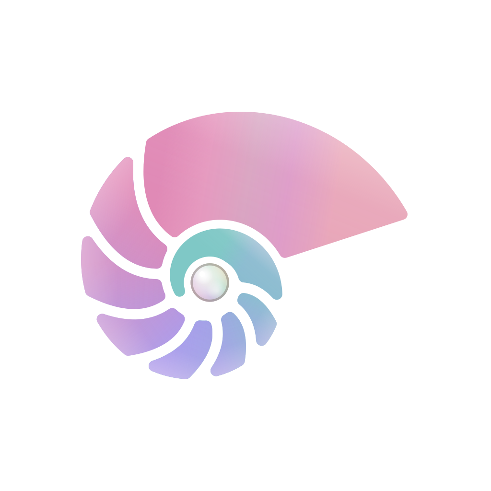

<p align="center"></p>
<h1 align="center">Orient</h1>
<p align="center">Wallpaper colors. Readable palettes. Themes anywhere.</p>
<p align="center"><a href="#try-it">Get started</a> · <a href="#what-it-does">Features</a> · <a href="#using-palettes-and-templates">Templates</a> · <a href="https://github.com/nacre-desktop/nacre">Nacre</a></p>

**[Development preview · 0.1.0-dev.5](https://github.com/nacre-desktop/orient/releases/tag/v0.1.0-dev.5).** The engine works and has regression tests;
its public packaging/API is being stabilized before a 1.0 release.

Orient is a standalone Python library and CLI. It analyzes images or sampled
animation frames, preserves source color families, and creates readable dark/light
palettes. It does not require Hyprland, Quickshell, Nacre, a display server or a
running desktop. [Nacre](https://github.com/nacre-desktop/nacre) is one consumer.

## Try it

Python 3.13+ is required. Once the maintainer approves the PyPI release:

```sh
python3 -m venv .venv
.venv/bin/python -m pip install --pre orient-colors
.venv/bin/orient --version
.venv/bin/orient palette wallpaper.jpg --personality natural --mode dark > palette.json
.venv/bin/orient analyze wallpaper.jpg
.venv/bin/orient sample wallpaper.jpg 0.5 0.5
.venv/bin/orient export palette.json ./themes
.venv/bin/orient render palette.json ./my-template.css > ./colors.css
```

Development previews need `--pre` or an exact version pin. Stable releases use
`pip install orient-colors`. Until production approval, use the
[TestPyPI installation instructions](docs/development/releasing.md#fresh-testpypi-installation)
or install from source:

```sh
git clone https://github.com/nacre-desktop/orient.git
cd orient
python3 -m venv .venv
.venv/bin/python -m pip install .
```

The distribution name is `orient-colors`; the command and import module are
`orient`. FFmpeg enables video frame sampling; still images and animated GIFs
use Pillow. Arch's package recipe is [python-orient-colors](packaging/arch/).

## Python library

```python
from orient.engine import from_image
from orient.export import export, render

palette = from_image("wallpaper.jpg", mode="dark", personality="natural")
css = render(":root { --accent: #{{primary}}; }", palette)
files = export(palette, "./themes")
```

Choose a fresh export directory; existing files are never silently replaced.
See the [stable entry points](docs/api.md), [palette JSON format 1](docs/palette-json.md)
and [0.x versioning policy](docs/versioning.md).

## What it does

- Natural, Pigment, Harmony, Pop, Mist, Vivid, Pearl and Tide personalities.
- Independent accent-tinted or wallpaper-derived backgrounds.
- Perceptual grouping, source coverage/regions, salience and stable frame sampling.
- Text contrast diagnostics and color-vision simulations.
- Semantic terminal colors and portable export templates.
- Orient tokens and supported Matugen color expressions, loops, filters and
  conditions. Arbitrary scripting and includes are intentionally unsupported.

Palette JSON has an independent `formatVersion` (currently **1**). The package's
0.x version does not reset this schema. Exact engine fingerprints invalidate
stale caches; previews never change your desktop. Export writes only the directory
or stdout explicitly requested. Nacre owns live palette publication.

## Using palettes and templates

The CLI prints JSON for palette/analyze/sample queries. Use `orient export` to
write themes into the directory you select, or `orient render` for a template on
stdout. JSON `formatVersion` is 1; the engine version is independent. The built-in
templates target terminals/editors and common desktop applications. Matugen color
expressions, color-map loops and the supported filters/conditions work alongside
Orient tokens; arbitrary scripts/includes are not executed.

The engine uses a private XDG cache and never applies desktop settings. Use Nacre
or another caller to publish a palette. Point samples, source regions/coverage and
contrast/vision diagnostics are included for applications that build previews.

Orient-owned code is **MIT**: [LICENSE](LICENSE). Pillow is an independently
installed dependency with its own license. Original synthetic regression images
are public-domain fixtures. See [CHANGELOG](CHANGELOG.md) for user-facing changes.

The earlier integration used GPL-licensed Caelestia tooling; the standalone engine
is an independent implementation. See the [implementation-origin record](docs/provenance.md).

For development checks and PR expectations, see [Contributing](CONTRIBUTING.md).
Report vulnerabilities through the private channel in [Security](SECURITY.md).
